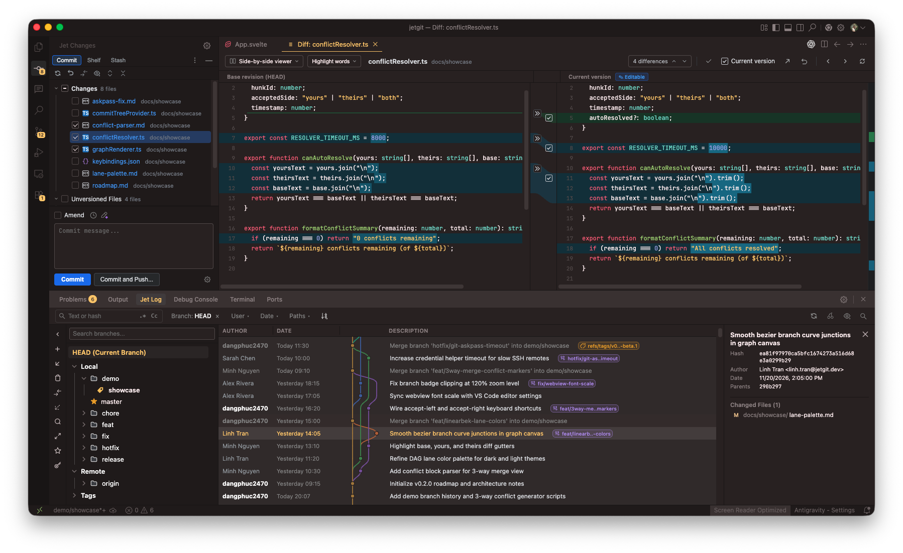
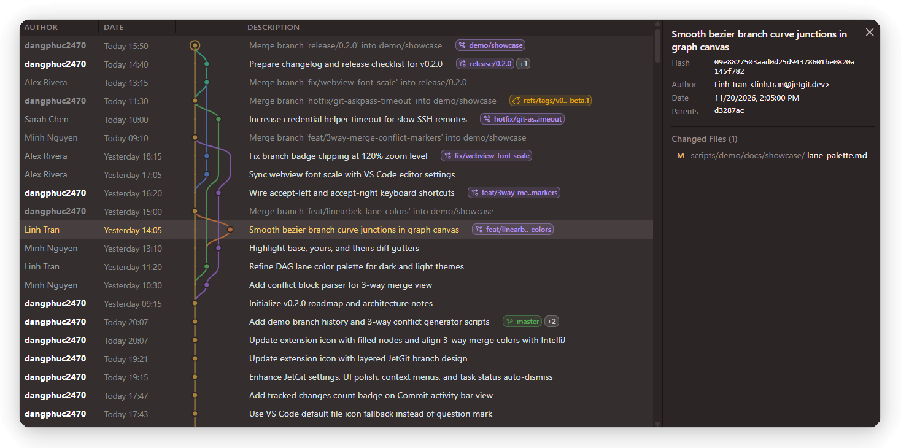
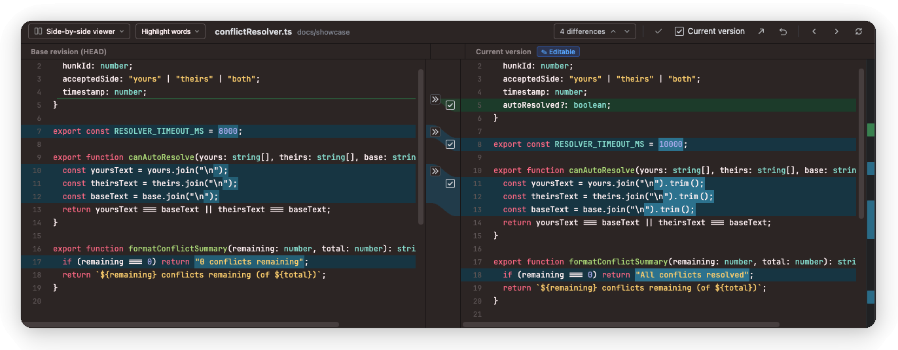
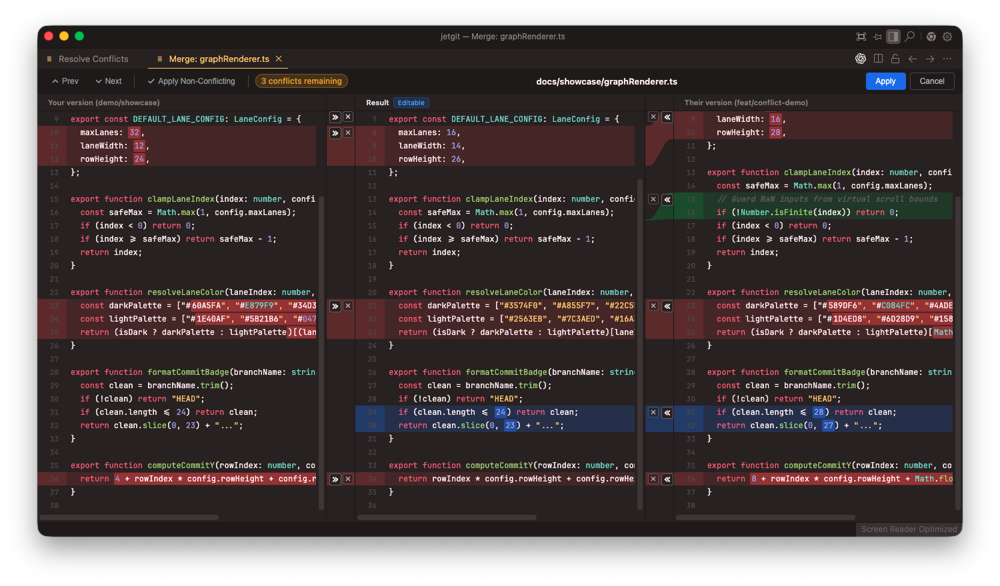
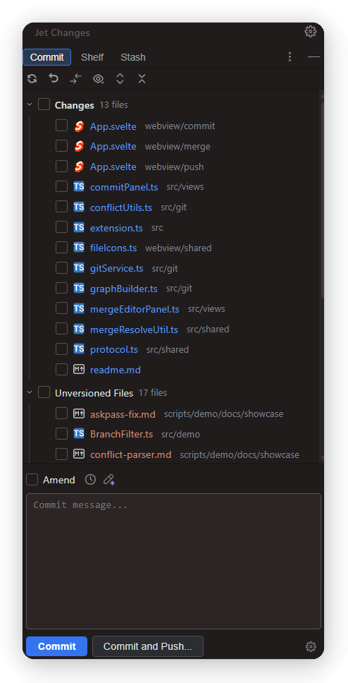
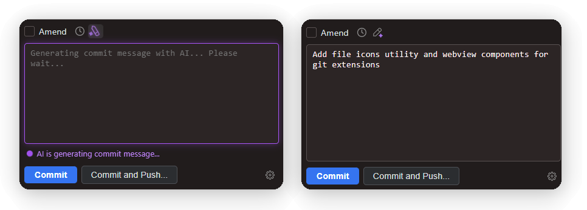
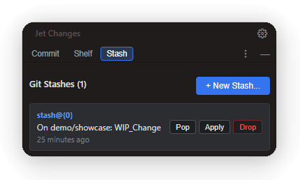
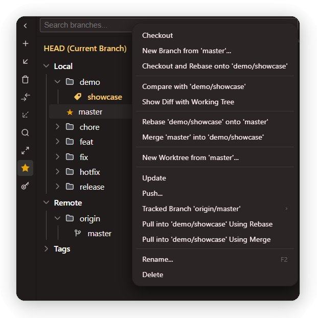
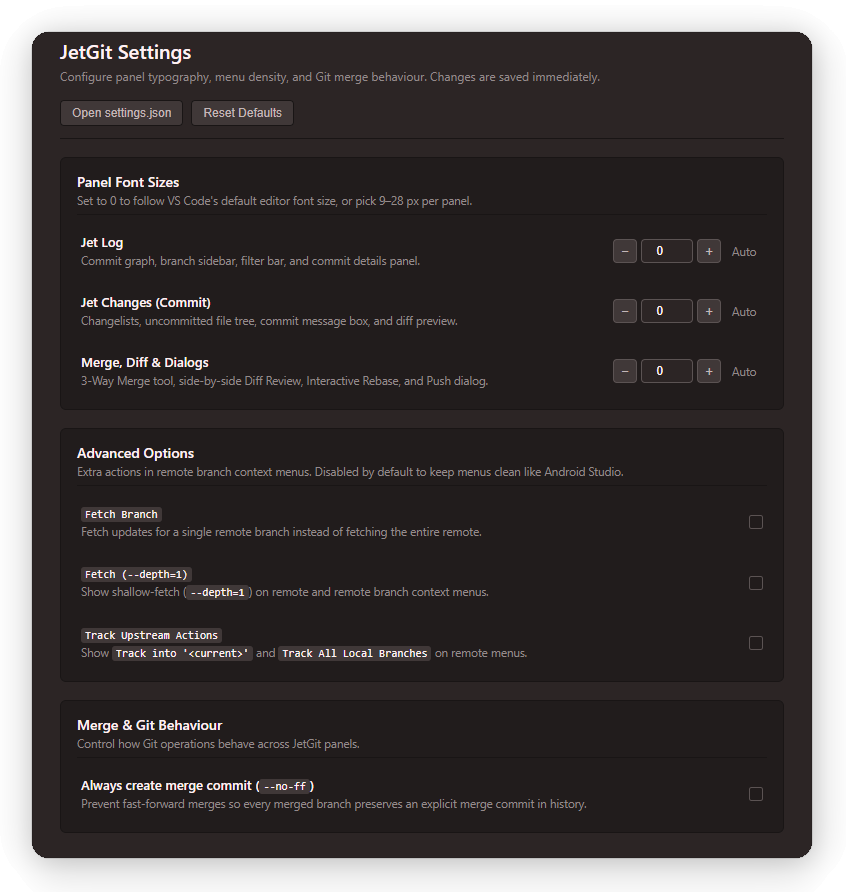

  

<h1 align="center">JetGit</h1>

  IntelliJ &amp; JetBrains style Git client for VS Code, Cursor, Windsurf, and Antigravity. 
  Powered by <strong>Svelte 5</strong> and the <strong>LinearBek DAG graph engine</strong>.

 

 
---
 
## Features
 
### Visual Commit Graph (`Cmd+9` / `Ctrl+Shift+9`)
Smooth Bezier commit graph with **LinearBek** layout, instant filtering (text, hash, branch, author, date, path), and a commit details inspector.

### Side-by-Side Diff Review
2-way diff viewer with **word-level inline highlights**, SVG gutter ribbons, editable working copy, hunk revert (`>>`), and partial block staging.
 

### 3-Way Merge Tool
IntelliJ-style **Yours / Result / Theirs** merge editor with synchronized scrolling, color-coded conflict/change gutters, and one-click or bulk non-conflicting resolution.

### Commit Window, Changelists, Stash & AI Commit (`Cmd+K` / `Ctrl+K`)
Group changes into custom changelists, switch tree/flat views, manage Git Stashes (`Pop`, `Apply`, `Drop`), amend commits, and generate commit messages with AI.

| AI Commit Message | Stash Manager |
| :---: | :---: |
|  |  |

### Branch Manager & Context Menus
Organized `HEAD`, Local, Remote, and Tags tree with full actions (Checkout, Compare, Merge, Rebase, Worktrees, Push, Pull, Rename, Delete), plus standalone Push and Conflicts dialogs.

### Interactive Rebase
Drag-and-drop commit reordering with `pick`, `reword`, `edit`, `squash`, `fixup`, and `drop` directly from Git Log.

### Settings
Tune per-panel font sizes, advanced remote fetch menu density, and `--no-ff` merge behaviour.

---

## Keyboard Shortcuts
 
| Action | macOS | Windows / Linux |
| :--- | :--- | :--- |
| **Open Git Log** | `Cmd+9` | `Ctrl+Shift+9` |
| **Commit Tool Window** | `Cmd+K` | `Ctrl+K` |
| **Next / Previous Diff** | `F7` / `Shift+F7` | `F7` / `Shift+F7` |
 
---
 
## Requirements

- VS Code `^1.85.0` or compatible editors (Cursor, Windsurf, Antigravity, Void, VSCodium).
- Git `2.0+` in your system `PATH`.
 
---

## Acknowledgements & Credits

Originally based on `intellij-git-ext` by **Murat Böck** ([muratbock.com](https://muratbock.com)).  
Rewritten with Svelte 5, modernized with the LinearBek DAG engine, and maintained by **Dang Phuc** ([github.com/dangphuc2470](https://github.com/dangphuc2470)).

---

## Disclaimer & License

JetGit is an independent open-source extension and is not affiliated with or endorsed by JetBrains s.r.o.  
[MIT License](LICENSE) — Copyright (c) 2024 Murat Böck, Copyright (c) 2026 Dang Phuc.
